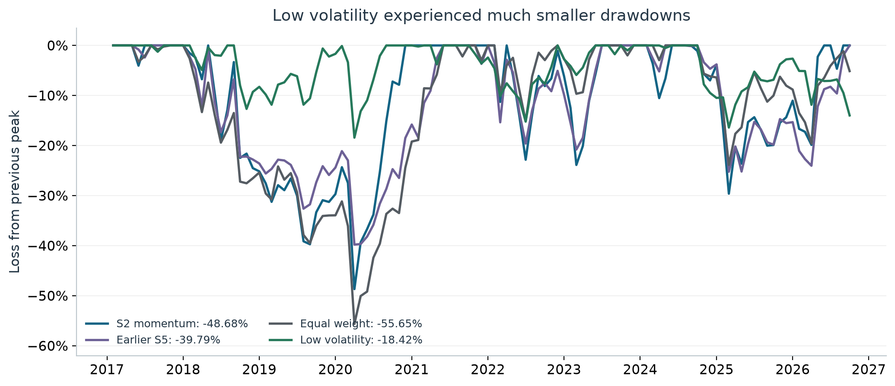
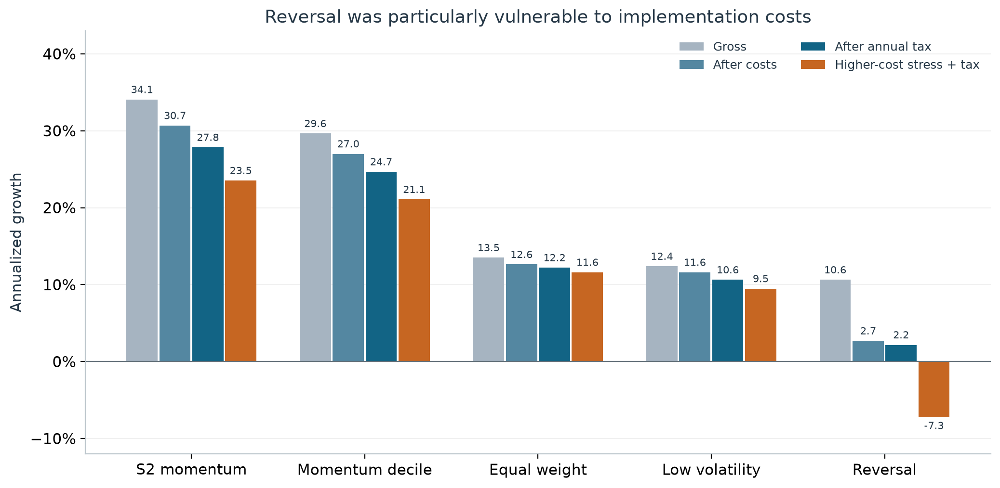
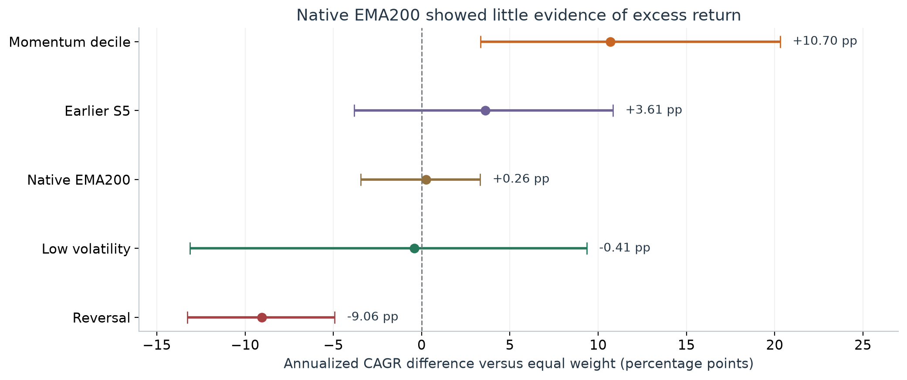

# India Anomaly Lab

## What survives a more realistic Indian-equity backtest?

**Final project report · 15 October 2026**

Independent NSE replay · February 2017–September 2026 · 116 completed holding months

**Simple momentum produced the strongest simulated growth. Low volatility provided the smallest observed losses. The native Stockers adaptation showed little evidence of an advantage over equal weighting. Unresolved execution data prevents a claim of proven, tradable performance.**

This report explains the results, the trade-offs behind them, and the evidence still missing. It follows the completed price-return audit; separate dividend and older-history sensitivities remain in the technical appendix. No strategies were retuned or rerun to produce this report.

## 1. What we tested

We tested whether familiar stock-market strategies still worked when applied to Indian equities with trading costs, taxes, historical stock eligibility and failed companies retained. The study covered momentum, short-term reversal, low volatility, trend filters, the earlier team strategy and adaptations of the uploaded Stockers engine. The planned family contained 30 variants and two controls.

The underlying independent NSE rebuild contains more than **5.1 million daily security observations across 3,625 linked identities**, drawn from 2,671 daily archives and 563 weekly PR archives. Downloads span January 2016–13 October 2026. The first year primarily supplies feature history; the main matched comparison starts in February 2017.

Each month, the research universe selects up to 500 eligible non-fund securities using historical liquidity, price and trading-history filters. It is a historical liquidity universe, rather than a reconstruction of Nifty 500 membership. The control spreads capital equally across the same eligible universe and rebalances; it is not a static buy-and-hold index.

**How to read the numbers.** The headline scenario starts with INR 10 lakh, uses price returns, deducts modeled trading costs and periodic tax payments, and assumes zero recovery on existing unresolved exposures. It rejects unavailable purchases, including checks of future holding-return availability. That introduces hindsight. These conditional simulations are neither causal execution backtests nor lower bounds on achievable returns. Terminal liquidation tax is shown separately; terminal trading fees are omitted.

## 2. The clearest growth result came from simple momentum

S2 ranks stocks by prior 12–1 momentum: roughly their previous year's performance excluding the latest month. It selects up to 30 names, targets one-thirtieth of capital per name and leaves unused slots in zero-yield cash. Signals form at month-end, with intended execution at the following month's first market-session open.

Under the stated assumptions, S2 generated **${s2_cagr} annualized growth**, taking INR 10 lakh to **INR ${s2_final_lakh} lakh**. After estimated terminal liquidation tax, annualized growth was **${s2_terminal_cagr}**. The simpler momentum-decile portfolio—selecting the strongest 10% of eligible names, rather than ten stocks—returned **${momentum_cagr}**.

*Figure 1. All paths use the same 116 months and initial capital. The logarithmic scale shows proportional growth. Values precede terminal liquidation tax. Assumed recoveries and future-availability checks limit executability.*

${comparison_table}

*Sharpe ratios assume a zero risk-free rate. Final wealth includes periodic tax payments but precedes terminal liquidation tax. CAGR is annualized compounded growth, rather than a return earned every year.*

Adding complexity did not consistently improve the result. S3's trend filter lowered annualized growth to **${s3_cagr}** while worsening maximum drawdown to **${s3_drawdown}**. S5, the earlier team approximation, returned **${s5_cagr}** with a **${s5_drawdown}** maximum drawdown. Its filters changed the balance between growth and losses, but did not outperform simple S2 on this matched history.

S2 is the best observed return outcome among portfolios sharing this history. It was selected from an already examined family; its ranking is not a prospective validation of the selected winner.

## 3. Strong growth still involved losing almost half the peak value

S2's maximum drawdown was **${s2_drawdown}**. A portfolio at a hypothetical INR 10 lakh peak would fall to approximately **INR ${s2_peak_remaining} lakh** under a decline of that magnitude. The corresponding equal-weight decline was **${ew_drawdown}**.

Low volatility offered a different trade-off. Selecting the lowest-volatility decile over a 12-month lookback produced **${lowvol_cagr} annualized growth**, with a maximum drawdown of **${lowvol_drawdown}**. At the same hypothetical peak, that decline would leave approximately **INR ${lowvol_peak_remaining} lakh**. These illustrations translate percentages; they are not balances observed on a common date.

*Figure 2. Each line measures loss from its own previous peak. A shallower line means a smaller observed decline. Drawdowns use monthly wealth observations and do not capture every intramonth loss.*

Low volatility had the smallest maximum drawdown among strategies sharing the 116-month history. Momentum delivered much stronger conditional growth. The evidence identifies that trade-off without establishing that either objective is universally preferable.

## 4. Trading costs changed which anomalies looked useful

Short-term reversal looked much stronger before implementation expenses. Buying recent losers generated **${reversal_gross} gross annualized growth**. That fell to **${reversal_costs} after modeled trading costs** and **${reversal_tax} after annual tax**. Under higher-cost stress, annualized growth became **${reversal_stress}**.

Momentum retained substantially more of its performance under the tested formulas: S2 returned **${s2_stress}** in the higher-cost scenario, and the momentum decile returned **${momentum_stress}**.

*Figure 3 and table. Gross portfolios fully rebalance; implemented portfolios use a 25% relative rebalance band. Differences therefore include both charges and trading-policy effects. Higher-cost stress retains annual tax and increases impact, brokerage and minimum half-spread assumptions; it is a separate simulation.*

${cost_table}

Reversal demonstrates why a return pattern before costs may provide little value after implementation. The results also show why fees, taxes and trading frequency must be examined together.

## 5. What happened to the original Stockers strategy?

The native Stockers adaptations and S5 are different implementations. Their entry timing, ranking and allocation rules differ. Native EMA100/200/300 refer to periods of the original engine's **monthly aggregation**, rather than daily moving averages. Their initialization also depends on the limited history before the 2016 boundary.

Among native adaptations, EMA300 performed best at **${native300_cagr} annualized growth**. EMA200 returned **${native200_cagr}**, compared with **${ew_cagr}** for equal weight over the full matched history.

The statistical comparison was less persuasive. Over January 2018–September 2026, native EMA200's annualized advantage over equal weight was just **${native_excess} percentage points**. Its bootstrap interval ran from **${native_lo} to ${native_hi} points**, including underperformance. All four tested block lengths produced intervals including zero.

*Figure 4. Points show estimated annualized CAGR differences; lines show 95% stationary-bootstrap intervals using mean block length 12, 1,999 resamples and seed 7. Dates are January 2018–September 2026. These individual-rule intervals do not adjust for selecting the winner from the full strategy family.*

The native engine did not establish a reliable excess-return advantage here. S5's stronger headline result cannot be attributed to the original engine because it implements different rules.

## 6. Momentum remained stronger in the later window, with uncertainty

${period_table}

*January 2018–September 2026: 105 months, the same conditional annual-tax scenario. These dates have already been examined and are not an untouched holdout.*

The momentum decile's estimated annualized advantage over equal weight was **${momentum_excess} percentage points**, with a block-12 interval of **${momentum_lo} to ${momentum_hi} points**. Its interval remained positive across mean block lengths 3, 6, 12 and 24. Those results support further momentum research under the assumptions used.

Testing many strategies also increases the chance of finding an impressive result by luck. The family-level tests address part of that problem, but different families have different available histories:

${family_table}

*Both tests use the conditional annual-tax price-return scenario. The broader family's shorter history reflects its common input availability. Its bootstrap uses 1,999 resamples. Unknown earlier strategy searches remain outside either correction.*

The broader family's SPA result is close to the conventional 5% threshold, while its White test is stronger. These are qualified, method-dependent findings. Neither a small p-value nor the marginal momentum interval establishes factor-neutral alpha or guarantees that the selected S2 winner will work in unseen data.

## 7. What the audit corrected

All 12 original gross-return series reproduced from the supplied monthly panel to within 1e-10. The arithmetic was reproducible, but several interpretations overstated what it demonstrated.

An interval labeled “after costs and taxes” had actually been calculated after costs only. Earlier family significance tests used gross returns. Timing corrections were needed for spread estimation, corporate-action matching and native warmup. Missing-price handling and cash-only month accounting also required correction. The claim-by-claim appendix preserves the details and favorable corroboration.

Fundamental value had only **14 observed holding months, March 2024–April 2025**, rather than 31 months of fundamental observations. The extra 17 months were cash-only months after the P/E feed ended. Over the corrected short sample, value returned **−6.20% annualized**, versus **+2.31%** for its matched control. Fourteen months cannot establish or refute a general value premium; long-horizon price cheapness is also not a substitute for publication-dated fundamentals.

## 8. What remains unresolved

When the model required observed execution and valuation prices without substituting recovery assumptions, **no strict all-history gross strategy path completed**. Missing observations include unresolved merger, conversion and suspension outcomes. A missing quote does not establish that an investor actually lost everything or sold at the last mark. Those proceeds must be reconstructed from primary records.

The two explicit recovery sensitivities retain these assumptions visibly. Their purchase checks sometimes consult future holding-interval availability, so even assumed zero recovery is not a fully causal or necessarily conservative trading policy. Fractional shares, unrestricted fills, simplified tax treatment and unmodeled trading queues further limit execution claims.

Scaling remains unproven. At INR 100 crore, the momentum decile showed **18.52% cost-only CAGR**, but exceeded its 10%-of-daily-traded-value diagnostic in **all 116 months**. Its largest order was about 7.07 times that daily-value proxy. The model reports breaches rather than enforcing partial fills; charging impact costs does not establish that the orders could have been executed.

## 9. What the completed checks establish

${checks_table}

*Counts above describe the frozen final price-return run. The separate recorded-dividend run has the same completion and failure counts. The 8,344 summaries are eight period views of completed paths, rather than 8,344 independent hypotheses.*

Passing software checks verifies specific behaviors and accounting identities. Failed strategy scenarios preserve unresolved economic evidence. The runner deliberately exits nonzero when failures remain; no old output was copied in to complete a failed dependency.

The work identifies **momentum as the strongest conditional growth candidate**, **low volatility as the strongest observed drawdown-control approach**, and **reversal as particularly vulnerable to costs**. It does not establish a native Stockers advantage or commercially deployable alpha.

Before an investable conclusion, the next study must resolve missing corporate-action proceeds and action gaps, calibrate fees and taxes, enforce integer shares and participation limits, and freeze rules before a genuinely unseen evaluation period. Longer publication-dated fundamental history is needed to evaluate value.

## Sources, downloads and reproduction

The report's figures and tables derive from the frozen `independent-nse-execution-price-v2` outputs. A small, published [report data snapshot](data/final_report/README.md) contains the selected monthly paths, all-history summaries, bootstrap intervals, family tests and provenance hashes. It reproduces this report without downloading the full raw archive; it does not replace the complete execution evidence.

- [PDF report](FINAL_PROJECT_REPORT.pdf) · [HTML report](FINAL_PROJECT_REPORT.html).
- [Reproduction audit](REPRODUCTION_AUDIT.md) · [claim review](CLAUDE_REPORT_REVIEW.md).
- [Replication protocol](../docs/REPLICATION_PROTOCOL.md) · [educational evidence explorer](../docs/site/audit.html).
- Regenerate figures, Markdown and HTML: `python scripts/build_final_project_report.py`.
- Render and check the PDF with Node, Playwright and Chromium: `node scripts/render_final_report.cjs`.

The research uses the original base revision `71658c9`; the audited implementation was published in commit `3ddd593`. Source snapshots and full-run hashes identify the actual numerical inputs. Updating this explanatory report does not rerun the backtests.
