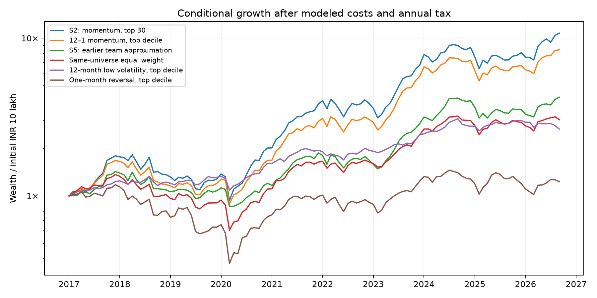
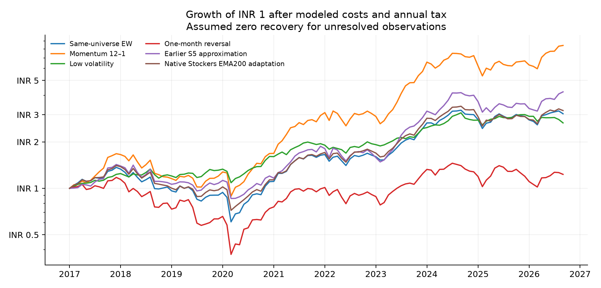
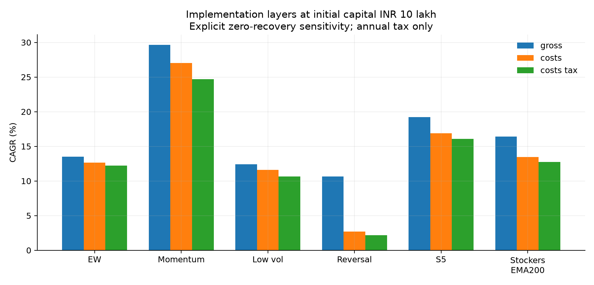

# India Anomaly Lab — final project report

15 October 2026 · Research and educational backtesting · Independent NSE replay

## Which strategy was best?

**S2, the simple 12–1 momentum portfolio holding up to 30 stocks, had the highest simulated after-cost/annual-tax CAGR among strategies with the same 116-month history: 27.85% per year.** After modeled terminal liquidation tax it was 26.98%. Its maximum drawdown was **48.68%**. This is the observed winner of an already examined model family, not a prospectively validated selection.

**Momentum was the strongest research candidate; no strategy has yet been established as an executable winner.** All strict all-history gross paths stop on missing invested prices or execution marks. The positive rankings below come from explicitly assumed recoveries and missing-entry handling. Some of that handling consults future interval availability, so even the zero-recovery sensitivity is not a causal execution backtest or a lower bound on achievable returns.

The simpler momentum decile returned 24.68% with a 46.96% drawdown. Adding the S3 trend filter reduced S2's return to 26.76% and did not reduce its worst drawdown. The S5 setup approximation returned 16.06%. More elaborate filters did not beat simple S2 on this matched full history. Among the three native Stockers adaptations, EMA300 had the highest full-history CAGR, 13.20%; EMA200 returned 12.76%. These use the uploaded engine's monthly EMA spans, not the daily EMA200 in S3/S5.

**For lower observed losses, 12-month low volatility had the smallest maximum drawdown among these matched-history strategies, 18.42%, with 10.63% CAGR.** That is a different objective from maximizing return. Short-term reversal was weak after frictions and lost money under higher-cost stress. Fundamental value has only 14 observed holding months and cannot support a full-history verdict.

## Results readers can compare

All rows below use February 2017–September 2026, 116 completed holding months, initial INR 10 lakh, price returns, all available histories, and `assume_total_loss:costs_tax`. Annual-tax CAGR includes modeled periodic tax payments; the separate terminal column deducts additional estimated liquidation tax. Terminal trading fees are omitted. Drawdowns use the annual-tax path before terminal liquidation. These are historical annualized rates, not yearly promises.

| Strategy | Annual-tax CAGR | After terminal tax CAGR | Maximum drawdown |
| --- | --- | --- | --- |
| S2: momentum, top 30 | 27.85% | 26.98% | -48.68% |
| S3: momentum + trend, top 30 | 26.76% | 25.87% | -49.90% |
| 12–1 momentum, top decile | 24.68% | 23.95% | -46.96% |
| S5: earlier team approximation | 16.06% | 15.38% | -39.79% |
| Native Stockers, monthly EMA300 | 13.20% | 12.80% | -44.03% |
| Native Stockers, monthly EMA200 | 12.76% | 12.30% | -48.74% |
| Same-universe equal weight | 12.21% | 11.75% | -55.65% |
| 12-month low volatility, top decile | 10.63% | 10.60% | -18.42% |
| One-month reversal, top decile | 2.18% | 2.18% | -68.30% |



The zero-recovery assumption writes off existing unresolved exposures. Unavailable target fills are rejected, including checks using future holding-return availability. Last-mark sensitivities are retained separately. Neither assumption reconstructs actual merger proceeds, conversion shares or suspension outcomes. Fractional shares, unrestricted fills and approximate tax/cost inputs further limit executability. No real-money trading was performed.

## Do costs erase the anomalies?

| Model | Gross | Costs | Annual tax | Higher-cost stress |
| --- | --- | --- | --- | --- |
| S2 | 34.07% | 30.68% | 27.85% | 23.53% |
| momentum12_top10 | 29.64% | 27.01% | 24.68% | 21.07% |
| EW | 13.51% | 12.63% | 12.21% | 11.61% |
| low_vol12_top10 | 12.39% | 11.60% | 10.63% | 9.49% |
| reversal_top10 | 10.63% | 2.70% | 2.18% | -7.26% |

Costs substantially reduce reversal: 10.63% gross becomes 2.70% after modeled trading costs and 2.18% after annual tax; the higher-cost stress is −7.26%. Momentum remains positive under the tested formulas: S2 is 23.53% in higher-cost stress, and the momentum decile is 21.07%. Persistence under an assumed formula does not establish realizable profitability. Gross uses full rebalancing; implemented layers use a 25% relative rebalance band, so the gaps include policy changes as well as charges. The higher-cost stress retains annual tax and sets impact coefficient k=1.5, brokerage=0.003 and minimum half-spread=0.001; it is a separate simulation, not an arithmetic subtraction from this table.

At INR 100 crore, momentum decile's cost-only CAGR is 18.52%, but it exceeds the 10% daily traded-value diagnostic in all 116 months; the largest order is approximately 7.07 times the proxy. S2's corresponding CAGR is 17.76%, so the return ranking also changes with capital. The engine reports breaches rather than enforcing partial fills. No capacity claim follows from these curves.

## Different periods and statistical uncertainty

| Window | Model | First | Last | Months | CAGR | Max drawdown |
| --- | --- | --- | --- | --- | --- | --- |
| 2018_on | EW | 2018-01 | 2026-09 | 105 | 9.58% | -55.65% |
| 2020 Covid | EW | 2020-02 | 2020-12 | 11 | 19.09% | -35.58% |
| 2021-24 retail boom | EW | 2021-01 | 2024-09 | 45 | 32.90% | -15.15% |
| 2018_on | momentum12_top10 | 2018-01 | 2026-09 | 105 | 20.28% | -46.96% |
| 2020 Covid | momentum12_top10 | 2020-02 | 2020-12 | 11 | 35.01% | -30.34% |
| 2021-24 retail boom | momentum12_top10 | 2021-01 | 2024-09 | 45 | 48.62% | -19.86% |
| 2018_on | reversal_top10 | 2018-01 | 2026-09 | 105 | 0.52% | -68.30% |
| 2020 Covid | reversal_top10 | 2020-02 | 2020-12 | 11 | 13.71% | -43.25% |
| 2021-24 retail boom | reversal_top10 | 2021-01 | 2024-09 | 45 | 18.62% | -22.90% |
| 2018_on | low_vol12_top10 | 2018-01 | 2026-09 | 105 | 9.17% | -18.42% |
| 2020 Covid | low_vol12_top10 | 2020-02 | 2020-12 | 11 | 22.94% | -18.33% |
| 2021-24 retail boom | low_vol12_top10 | 2021-01 | 2024-09 | 45 | 18.98% | -15.22% |
| 2018_on | S2 | 2018-01 | 2026-09 | 105 | 22.69% | -48.68% |
| 2020 Covid | S2 | 2020-02 | 2020-12 | 11 | 51.07% | -32.19% |
| 2021-24 retail boom | S2 | 2021-01 | 2024-09 | 45 | 49.07% | -23.87% |

The episode table is clipped to the exact dates shown; its 11-month Covid window is a short descriptive sample, and its annualized CAGR is not a full-year observation or an inference result.

The 2018-on window contains 105 months: S2 returns 22.69%, momentum decile 20.28% and EW 9.58%, under the same annual-tax sensitivity. This window has already been examined and is not an untouched holdout. The independently downloaded archive cannot test the 2008 crisis or 2013 taper episode. Separate runs on uploaded processed history cover February 2007–August 2026, 235 months: momentum decile 16.38%, EW 9.26% and reversal −9.49%. Those older years lack independently rebuilt daily opening evidence and are reported separately.

The original 12-rule family on January 2018–September 2026 has conditional annual-tax SPA p=0.0025 and White p=0.0205. The broader 29-price-rule family must use its shorter common history, February 2021–September 2026, 68 months: SPA p=0.0540 and White p=0.0095. With recorded dividends its SPA p is 0.0555. These different tests/windows answer different questions. Near-threshold values with 1,999 bootstrap resamples are not definitive; the original historical search count remains unknown.

For the momentum decile versus matched EW over the original-grid window, the annualized CAGR difference is 10.70 percentage points, with stationary-bootstrap block-12 interval [3.33, 20.31]. All tested block lengths 3/6/12/24 keep that interval positive. Native Stockers EMA200's excess is only 0.26 points, interval [−3.46, 3.32]; all four intervals include zero. A marginal interval for one rule is not a family-adjusted probability that the selected S2 winner will work. Factor-neutral alpha, exact Indian-paper replication and a genuinely unseen prospective test remain unestablished.

## How the project was made

1. Preserved the uploaded programs, reports and result files unchanged under `artifacts/supplied/`, with hashes. Documents were treated as evidence rather than instructions. Kept the original 7,108-line Stockers upload byte-identical and invoked its own signal/position methods through an offline India adapter.
2. Downloaded NSE archives from 1 January 2016 through 13 October 2026. Checked all 3,939 calendar dates to retain exceptional weekend sessions. Preserved 2,671 daily ZIPs and 563 weekly PR ZIPs with URL/status/time/byte-count/SHA-256 manifests and CRC/schema/date validation. Unavailable 404 archives are not independently authenticated holidays.
3. Parsed old and UDiFF formats into dated prices, OHLC, volume and INR turnover. Retained EQ/BE/BZ, resolved duplicate symbol/session rows by traded value, and linked dated renames/ISINs with symbol-reuse epochs. Built 5,117,493 security-days, 3,625 linked identities and 13,967 action records. Froze input inventories before running models.
4. Applied recorded splits/bonuses and frozen action-detector settings. Compared 13,950 common supplied/downloaded action keys: factors and dividends agree within 1e-8. Verified implied traded-value units across all 5,117,493 traded rows. Retained unresolved extreme-return and overnight-gap investigations rather than deleting them silently.
5. Constructed monthly features and a historical liquidity universe: up to 500 non-fund names, price at least INR 20, at least 10 traded sessions in the signal month, at least 13 observed historical months, ranked by the trailing six-month median daily traded-value proxy. This is a historical liquidity universe, not historical Nifty 500 membership. The broad download itself is not a claim of perfect all-equity coverage.
6. Computed signals at month-end t and required observed market-first-session openings at t+1 and t+2. Excluded incomplete final intervals. 2016 is primarily feature warmup; the common main holding sample starts February 2017. S2 ranks adjusted price(t−1)/price(t−12)−1, targets 1/30 per selected name and leaves unused slots in zero-yield cash. Momentum `top10` means the top decile, not ten stocks; `top20` means top quintile.
7. Ran 30 planned variants plus two controls through 21 implementation layers and two universe views. The intentionally biased view deletes eventual exits only to demonstrate survivorship effects. Strict mode fails on unresolved invested marks; explicit last-mark and zero-recovery sensitivities remain separately labeled. Applied trading-cost, annual-tax, stress and capital scenarios and saved every completed monthly path and failure.
8. Reconciled the old outputs, executed all E0–E10 entry points in isolated directories, ran software/native-engine checks, inspected output accounting, performed separate matched-window statistical tests, and built a browser-tested educational explorer. No broker integration or live orders were used.

The uploaded native engine retains its original additional direct-entry month lag, monthly aggregation and EMA spans. Its India adapter uses completed-session warmup and historical eligibility, and applies rupee costs/tax. The earlier S5 approximation has different ranking, slot and timing rules; it is not a native-engine reproduction. Nine exported examples reconcile 272 active observed native monthly returns to the India underlying calculation within 1e-8, with maximum discrepancy approximately 1.44e-15. This checks specific calculations, not every line or missing-price liquidation.

## What was wrong or overstated in Claude's reports?

All 12 original gross-return series reproduce from the supplied monthly panel to within 1e-10. Their arithmetic was not invented. But the original cost-only momentum confidence interval was labeled after-tax, and original family significance tests used gross returns. A hardcoded credibility flag was not a measured test. The reported deflated Sharpe did not support the strongest certainty claim.

The old value calculation counted 31 calendar months including 17 cash-only months after the fundamentals feed ended. Only 14 observed signal months exist, producing March 2024–April 2025 holdings. Corrected conditional after-cost/annual-tax value CAGR is −6.20%, versus +2.31% for its available-data EW control; inference is unrun below 24 months. Five-year price cheapness and long-term reversal are price proxies, not fundamental value.

The audit also corrected future spread-pair timing, backward ex-date matching, native warmup timing, cash-month accounting, missing-invested-return handling, initial-capital drawdowns, finite-bootstrap p-values and April tax withdrawal after assumed losses. The broad “no look-ahead” claim exceeded what the old tests demonstrated. Smooth impact curves did not establish liquidity capacity. The full claim review, including favorable corroboration and exact limitations, is appended below.

## Proof of work and how to inspect it

These are executed artifacts, not proposed tests. Each of the price and recorded-dividend final runs has **54/54 software tests passing, 12/12 original native toy checks passing, 1,043 completed monthly paths, 8,344 summary rows and 301 failed model/scenario records**. No global parsing error occurred and numerical source hashes were unchanged during each run. All 1,043 saved paths per run pass finite-return, nonnegative-charge and wealth-recursion checks. The runner intentionally exits 1 when model failures remain. Those failures do not mean the software tests failed, and passing software tests do not prove profitable trading.

32 portfolios × 21 layers × 2 views = 1,344 attempted combinations = 1,043 completed + 301 failed. The 8,344 summaries are eight period views of completed paths, not 8,344 independent hypotheses. Every original E0–E10 entry point was attempted: E0/E1/E5/E10 exit 0; E2/E3/E4/E6/E7/E8/E9 exit 1 under strict missing-price handling. No old outputs were copied in to complete failed runs.

| Evidence | Inspect this artifact relative to repository root |
| --- | --- |
| Exact final ranking, dates and cost/tax scenarios | `artifacts/research/independent-nse-execution-price-v2/summary.csv` |
| New matched ranking and period extraction | `artifacts/research/final-project-report/` |
| Actual failed security/month reasons | `artifacts/research/independent-nse-execution-price-v2/failures.json` |
| Test result and logs | same run: `tests.xml`, `pytest.log`, `stockers_self_tests.log` |
| Actual commands, environment and run-time source hashes | same run: `evidence.json`, `source_at_start.json` |
| Frozen input names, sizes and hashes | same run: `input_inventory.json` |
| Every monthly wealth/cost/tax path | same run: `returns/` |
| Accounting checks and statistical evidence | same run: `output_path_checks.json`, `statistics.json`, `original_grid_statistics.json`, `block_length_sensitivity.csv` |
| Raw retrieval provenance | `data/raw/manifest.csv`, `manifest_pr.csv`, `download_attempts.csv` |
| Actual parsed panels and lineage | `artifacts/research/independent-nse-inputs/processed/`, `lineage.json` |
| Interactive-tool browser checks | `artifacts/research/browser-check/browser_results.json`, desktop/mobile screenshots |
| Legacy experiment execution logs | `artifacts/research/legacy-independent-final/` |
| Unchanged user uploads | `artifacts/supplied/upload_manifest.json` and original files |

Original Stockers SHA-256: `b037f944b3bff5db60d01552582c80ce65a4234b1e7f1bb21775418ab5f00c9a`. Base Git revision: `71658c943d7b0e975d9e7d24ba88bc90614d826c`; audited changes are a local source overlay, not a new remote release. Python 3.12.14 and `requirements-research.lock.txt` record the environment. Hashes prove byte identity, not independent publisher authenticity. This report generator saves a focused evidence hash manifest and independently recalculates plotted CAGRs from the saved monthly wealth paths. It does not rerun or tune strategies.

To reproduce from the extracted input archive, from the project checkout and installed locked environment:

```bash
.venv/bin/python scripts/run_research_audit.py --mode real --reuse-processed \
  --data-root /path/to/nse-inputs-2016-2026 --out artifacts/research/NEW_RUN
```

Use a new output directory. Preserve both success paths and `failures.json`, including the deliberate nonzero overall exit. See `docs/REPLICATION_PROTOCOL.md` for details. The educational explorer is `docs/site/audit.html`; its downloaded ledger exposes all 8,344 rows and 301 failures. Browser verification found no page errors or outer mobile overflow and checked filters, bias warnings, strict failures and JSON export.

## What this project establishes, and what comes next

The project is a reproducible exploratory evidence base and educational prototype. It corroborates old gross arithmetic, demonstrates substantial friction costs for reversal, identifies momentum as the strongest conditional candidate, and exposes material execution and inference gaps. It does not establish clean value evidence, a native Stockers advantage or commercially deployable alpha. It has no Stanford affiliation or external academic validation.

Before an investable conclusion, reconstruct merger/share-conversion and suspension outcomes; verify unexplained action gaps and calendar coverage; obtain publication-dated fundamental history; enforce integer shares, participation limits and real execution rules; calibrate historical fees and review tax treatment; and freeze a prospective evaluation period. The existing educational tool could support a research product, but startup demand, licensing and investment-service obligations have not been validated. Avoid marketing the historical winner as “AI-powered alpha.”

## Complete matched-history model ledger

These are all portfolios with the same 116-month full history, ranked by the annual-tax sensitivity used above. Sharpe assumes a zero risk-free rate. The return winner also leads this particular Sharpe column, but neither is an adjusted test of the selected winner.

| Rank | Model ID | CAGR | Max drawdown | Sharpe, zero cash rate |
| --- | --- | --- | --- | --- |
| 1 | S2 | 27.85% | -48.68% | 1.01 |
| 2 | S3 | 26.76% | -49.90% | 1.01 |
| 3 | momentum12_top10 | 24.68% | -46.96% | 0.98 |
| 4 | momentum12_top20 | 21.47% | -41.67% | 0.94 |
| 5 | momentum6_top10 | 19.09% | -46.33% | 0.81 |
| 6 | S5_n20 | 18.80% | -39.32% | 0.85 |
| 7 | momentum6_top20 | 17.98% | -47.94% | 0.82 |
| 8 | S4 | 17.46% | -29.25% | 0.96 |
| 9 | S7 | 16.75% | -36.19% | 0.84 |
| 10 | S6 | 16.43% | -40.13% | 0.81 |
| 11 | S5 | 16.06% | -39.79% | 0.78 |
| 12 | S8 | 15.05% | -36.62% | 0.79 |
| 13 | high_52w_top20 | 14.17% | -34.50% | 0.80 |
| 14 | high_52w_top10 | 14.11% | -35.31% | 0.78 |
| 15 | S5_n50 | 13.88% | -37.70% | 0.73 |
| 16 | Stockers_EMA300 | 13.20% | -44.03% | 0.72 |
| 17 | Stockers_EMA200 | 12.76% | -48.74% | 0.69 |
| 18 | S1 | 12.29% | -49.73% | 0.67 |
| 19 | EW | 12.21% | -55.65% | 0.64 |
| 20 | Stockers_EMA100 | 10.81% | -51.73% | 0.60 |
| 21 | low_vol12_top10 | 10.63% | -18.42% | 0.83 |
| 22 | low_vol12_top20 | 10.54% | -23.05% | 0.77 |
| 23 | low_vol6_top20 | 10.24% | -28.38% | 0.74 |
| 24 | low_vol6_top10 | 9.57% | -19.63% | 0.77 |
| 25 | reversal_top20 | 5.25% | -64.23% | 0.33 |
| 26 | reversal_top10 | 2.18% | -68.30% | 0.22 |

The remaining models have shorter input histories and are not ranked against the 116-month sample:

| Model | First holding month | Last holding month | Months | CAGR |
| --- | --- | --- | --- | --- |
| ltrev_top20 | 2021-02 | 2026-09 | 68 | 20.42% |
| ltrev_top10 | 2021-02 | 2026-09 | 68 | 20.16% |
| cheap5y_top20 | 2020-01 | 2026-09 | 81 | 11.97% |
| cheap5y_top10 | 2020-01 | 2026-09 | 81 | 9.26% |
| value_ey_top10 | 2024-03 | 2025-04 | 14 | -6.20% |
| EW_value_available | 2024-03 | 2025-04 | 14 | 2.31% |

## Technical audit appendix

The following is the full reproduction audit, retained with its detailed source, bias, tax, benchmark and dividend discussion.

## Indian equity anomalies: reproduction audit

Updated 15 October 2026. **Execution-aware independent NSE replay, updated 15 October 2026; actual opening marks required at both interval endpoints.** Evidence generated at 2026-10-15T02:28:50.138483+00:00.

### Finding

The supplied reports contain reproducible gross-return arithmetic, but their strongest profitability statements are not established. All 12 original gross series match fresh calculations from the supplied monthly panel. The report labels a cost-only momentum confidence interval as after-tax, and its original family tests use gross returns. Missing economic exit prices stop several strict simulations. A signal unit test does not establish that every cost, corporate-action and execution path is free of look-ahead.

Momentum remains a candidate for further study under the modeled scenarios. Short-term reversal loses much of its return to implementation frictions; a positive gross return is insufficient. Full-history fundamental value is not established. The uploaded native Stockers engine is a different strategy from the older S5 approximation and is evaluated separately. No commercial or real-money trading conclusion follows from this study.

Read [the claim-by-claim report review](CLAUDE_REPORT_REVIEW.md) for exact claims, code traces and the independent monthly-panel reconciliation. Original reports, books and result files remain preserved under `artifacts/supplied/`; uploaded documents were treated as evidence, not instructions.

### Data and reproducibility

This run parsed **2,671 downloaded daily ZIP archives, 5,117,493 security-days and 3,625 linked security identities**, covering **2016-01-01 through 2026-10-13**. This is the actual input period; the downloadable study was requested from 2016 onward and does not recreate the prior 2006-on raw archive. The earlier uploaded monthly panel spans January 2006–September 2026 and contains 417,383 security-months and 3,949 identities. It is a separate input source.

Input lineage is recorded in `artifacts/research/independent-nse-execution-price-v2/input_inventory.json`; the source freeze, Python/package versions, Git head, dirty working-tree state and executed commands are in `evidence.json`. Hashes identify bytes and do not independently authenticate the publisher. Reference files retrieved today aid identity linking and exit diagnostics; today's list never screens the primary historical universe. Partial builds that reuse the supplied corporate-action parquet explicitly say so in their snapshot label.

The downloader records URL, HTTP status, retrieval time, bytes and SHA-256; validates ZIP CRC, expected normalized schema and session date; and shares one request start per second across its I/O workers. All calendar days are checked to retain exceptional weekend sessions. HTTP 404 means an unavailable archive, not a verified holiday. Failed attempts are retained. Weekly PR archives provide action records and, when present, P/E snapshots; weekly sampling does not constitute a complete primary corporate-action tape.

Legacy and UDiFF columns are normalized to dated symbol/ISIN/OHLC/volume/value rows. EQ, BE and BZ are retained. Duplicate symbol/session rows keep the greater traded-value row. Identity links use dated renames and ISIN continuity, with separate symbol-reuse epochs. Corporate actions use recorded split/bonus ratios and frozen detector parameters (tolerance 0.08, minimum ratio 1.45); fitted detector grids are diagnostic, not future-selected adjustments. Demerger neutralization, inferred split gaps and rights omissions remain economic assumptions requiring verification. Some high-return observations may reflect action errors; lists for manual investigation are retained.

### Fresh executed checks

| Check | Outcome | Scope |
|---|---|---|
| Pytest | 54 tests, 0 failures, 0 errors, 0 skipped; exit 0 | Parsing fixtures, identities, actions, timing, accounting and statistical regressions |
| Uploaded engine self-tests | Command exit 0; individual results in the native CSV/log | 12 US cash-flow/mandate toy checks, not NSE anomaly significance |
| Recorded family | 30 planned variants, plus controls | Original 12, S1–S8, slot variants, price proxies, native EMA100/200/300 and earnings yield availability |
| Experiment summaries | 8,344 rows | Full and clipped periods, implementation layers and two data views |
| Model failures | 301 failed records; 0 unavailable records | Published in failures.json; never relabeled successful |
| Global replay error | none | A strict model failure still makes the overall runner exit nonzero |

The unchanged original Stockers upload is SHA-256 `b037f944b3bff5db60d01552582c80ce65a4234b1e7f1bb21775418ab5f00c9a`. Its original methods aggregate NSE daily bars, generate signals and compute open-to-open positions. Direct divergence entries retain the original additional month lag. The adaptation uses prior completed sessions for execution warmup, omits zero-volume bars, applies month-end India eligibility, equal weights active names, rupee frictions and Indian tax scenarios. The US manually chosen annual lists, US fees/factors, leverage and WGY obligations are not imported as Indian evidence.

Confirmed simulator corrections preserve cash-only months and intended cash under rebalance bands; reject missing invested holding returns; include initial capital in drawdown; date spread products only after both sessions complete; freeze corporate-action detector parameters; report participation; and prevent literal-zero finite-bootstrap p-values. Paper-gross paths also fail on missing invested prices. The uploaded engine file is byte-identical. These corrections change the interpretation of previous runs; historical outputs are preserved for comparison.

### Conditional results and failure visibility

The table below is **an explicit zero-recovery audit sensitivity**, not a verified fill policy. It assumes existing unresolved positions are written off and rejects target fills when their future holding return is unavailable. That latter rule uses hindsight; it cannot establish a causal execution strategy. Last-mark exit is the optimistic alternative. Strict layers stop on missing holding returns and publish the exact security/month. Merger shares, cash consideration, buyout payments and temporary suspension outcomes must be reconstructed before interpreting these assumptions as realizable performance.

Initial capital: INR 10 lakh. Returns include modeled trading charges and annual capital-gains tax; **terminal liquidation tax is additional** and is stored separately in summary.csv. Cash yield is zero in this new runner. Gross fully rebalances, while implemented layers use a 25% relative band, so gross/net differences include policy effects as well as charges.

| Portfolio | Actual holding dates | Conditional CAGR | Maximum drawdown | Months over 10% ADV |
|---|---|---:|---:|---:|
| Same-universe EW | 2017-02–2026-09 (116 months) | 12.21% | -55.65% | 0 |
| Momentum 12–1 | 2017-02–2026-09 (116 months) | 24.68% | -46.96% | 0 |
| Low volatility | 2017-02–2026-09 (116 months) | 10.63% | -18.42% | 0 |
| One-month reversal | 2017-02–2026-09 (116 months) | 2.18% | -68.30% | 0 |
| Earlier S5 approximation | 2017-02–2026-09 (116 months) | 16.06% | -39.79% | 0 |
| Native Stockers EMA200 adaptation | 2017-02–2026-09 (116 months) | 12.76% | -48.74% | 0 |





Individual rule histories can differ when long-horizon features first become available. Read actual first/last dates. A failed benchmark blocks its matched inference even when a particular strategy completes. Failed models are shown directly in the educational tool, alongside unavailable value and low-power windows.

### Costs, taxes and liquidity

Trading costs include dated STT/stamp schedules, approximate exchange/SEBI/GST/DP fees, observed-price spread proxies and square-root impact. Several historical fee entries remain modern constants or marked VERIFY. The runner evaluates cost-only, annual-tax, higher-cost stress and INR 1/10/100 crore capital scenarios. Maximum order divided by trailing daily traded value is published. Above 10% is a diagnostic breach; no participation constraint, circuit, auction, partial fill or order-book queue is simulated. A smooth capital curve does not establish capacity.

The resident-individual tax model tracks FIFO lots, dated regimes, exemptions, loss set-off/carry-forward, grandfathering and cess. It approximates long-term eligibility with 365 days, grandfather value with monthly marks, mixed-rate loss allocation and pro-rata withdrawals without additional realized gains. Surcharge and personal tax circumstances are omitted. Dividend-income taxation is omitted from the separate recorded-dividend sensitivity. Missing spread/volatility proxies default to zero and missing ADV gives zero modeled impact but a capacity flag; such scenarios need source review. Terminal liquidation tax is shown separately, and terminal trading fees are not added. These are research tax scenarios, not exact liabilities.

### Bias, periods and statistical evidence

The primary data view retains all available histories and never selects on future exit labels. The separately labeled deletion view removes eventual exits deliberately; its return changes quantify that shortcut, not every survivorship error. Missing firms/files, incorrect identity links, restated data, terminal recoveries and action valuations remain unresolved sources of bias.

Signals observed through close t earn first-open t+1 to first-open t+2 returns. Only complete holding intervals are included; the last partially observed interval is excluded. A 2016-only starting archive requires a feature warmup, so its primary holding sample begins later than January 2016. Future-price perturbation and warmup regressions validate specific paths, not a universal absence of look-ahead.

Full, through-2017, 2018-on and named historical episodes are reported with actual dates and observation counts. Episodes outside the archive are unrun; incomplete episodes are clipped. The 2018 split has already been examined and is not a fresh untouched holdout. All modifications in this task are exploratory replications, not newly preregistered evidence. The original preregistration document and tags are preserved and checked rather than rewritten to pass a guard.

Stationary-bootstrap CAGR-difference intervals jointly resample strategy/control months with seed 7, mean block length 12 and 1,999 resamples. Inferential windows need at least 24 months. White and Hansen SPA family tests are performed separately on gross, cost and tax layers over a common available price-family history; missing family members block inference. Degenerate excess series are listed. Earnings yield has a separate available-data EW control and a limited-history comparison. Finite p-values use `(1 + exceedances)/(B + 1)`. Deflated Sharpe counts at least the recorded family; historical unpublished searches remain unknown. Marginal confidence intervals and bootstrap sign proportions are not family-adjusted null probabilities.

The following broad price-family tests use the historical 2018-on window clipped to the family's common feature history. A p-value above 0.05 does not reject the tested family null at 5%, regardless of a large descriptive CAGR. The original 12-rule family is also reported separately in original_grid_statistics.json on its longer matched history; neither family accounts for unknown unpublished searches.

| Layer | Months | Evaluated price variants | SPA p | White p |
|---|---:|---:|---:|---:|
| assume_last_mark:gross | 68 | 29 | 0.0065 | 0.0015 |
| assume_last_mark:costs | 68 | 29 | 0.0140 | 0.0040 |
| assume_last_mark:costs_tax | 68 | 29 | 0.0620 | 0.0120 |
| assume_total_loss:gross | 68 | 29 | 0.0055 | 0.0015 |
| assume_total_loss:costs | 68 | 29 | 0.0135 | 0.0020 |
| assume_total_loss:costs_tax | 68 | 29 | 0.0540 | 0.0095 |

See statistics.json for the actual evaluated windows, omissions and tests. Statistical rejection is conditional on input quality and implementation assumptions. This harness does not establish factor-neutral alpha, causal identification or reliable future returns.

### Relationship to published anomalies

The price signals adapt established momentum (Jegadeesh and Titman, 1993), reversal (De Bondt and Thaler, 1985) and low-risk research to an NSE cash-equity universe. They are not exact recreations of those papers' original markets, weighting, financing or short-sale implementation. Fundamental value as in Fama and French (1992) requires historical publication-dated fundamentals; a price/five-year-mean proxy cannot replace them. Short-sample NSE P/E is disclosed as exploratory. A precise published Indian-paper reproduction requires its exact sample and protocol.

Family testing follows the White (2000) Reality Check and Hansen (2005) SPA approach; search-sensitive Sharpe interpretation follows Bailey and López de Prado (2014). The code and output reveal this project's choices; naming a method is not proof of exact numerical equivalence to an external implementation.

### Educational delivery and next research

`docs/site/audit.html` is a self-contained educational explorer of every model's dates, costs, taxes, capital, losses and failures, with a downloadable JSON ledger. It contains no broker integration or order execution. `docs/REPLICATION_PROTOCOL.md` provides commands and assumptions; `reports/CLAUDE_REPORT_REVIEW.md` reviews the earlier claims; `artifacts/research/independent-nse-execution-price-v2/` preserves machine-readable evidence. Original site pages carry a historical-result status notice.

Before a deployable investment conclusion, independently value all reorganizations and missing exits; verify the trading calendar and complete action tape; acquire publication-dated fundamentals and matched total-return benchmarks; calibrate and constrain execution; review tax accounting; and evaluate a prospectively locked future period. An educational evidence product is a reasonable prototype. Commercial viability, data rights and investment-service obligations have not been established. There is no real-money trading or AI-alpha claim.

### Execution and tax checks added to the final run

The headline run is `artifacts/research/independent-nse-execution-price-v2/`; the recorded-dividend sensitivity is `independent-nse-execution-dividends-v2/`. Earlier snapshots are preserved for audit history and do not supersede these results.

An investable holding interval now requires a positive observed opening quote with traded volume on the first archived market session at **both** endpoints. A later first trade in a month cannot supply the market's missing opening. The runner masks incomplete endpoint returns and passes actual opening availability to the portfolio engine. A fully exited position needs its current opening mark, even though it does not need the coming month's return. Missing entries or liquidations fail in strict mode. This prevents a stale carried mark from silently becoming an executable sale.

In the explicit sensitivities, unavailable target fills are rejected; existing unresolved exposures receive assumed last-mark proceeds or zero recovery. The future-interval checks in these sensitivities use hindsight and do not define a causal trading policy. No new entry or actual merger consideration is invented. Strict failure is a legitimate research result, not a zero-return observation. The April tax withdrawal also uses wealth *after* an assumed loss so that the full modeled prior-year tax bill is deducted. A hand-computed regression verifies INR 78,000 tax deducted from INR 750,000 remaining wealth.

Portfolio weights remain continuous: fractional shares are assumed. Integer-share requirements, auction access, trading circuits, queues and partial fills are not modeled. Some INR 10 lakh equal-weight allocations cannot purchase even one high-priced share. Thus baseline capacity diagnostics do not establish a fully executable retail portfolio. The native EMA spans are periods of the original monthly aggregation; long spans depend on initialization and the limited pre-2016 history. They are not silently replaced with daily EMA rules.

### Final verification and uncertainty

Both final runs pass **54 software tests and 12/12 uploaded native toy checks**, with zero software failures/errors/skips, no global parsing error and unchanged source hashes during execution. Each publishes **8,344 summary rows and 301 failed model/scenario records**. All **1,043 saved monthly paths** in each pass finite-return, nonnegative-charge and wealth-recursion checks. The overall command exit is deliberately 1 because failed scenarios remain. Under strict all-history execution, no gross rule path completes; inspect the missing merger/suspension marks rather than citing only successful assumed-recovery scenarios.

The broad 29-price-rule family shares 68 months. Its assumed-zero-recovery annual-tax SPA p-value is **0.0540** for price returns and **0.0555** with recorded dividends. These are near the nominal 5% boundary, with 1,999 resamples; do not treat a threshold crossing or noncrossing as definitive proof. Unknown earlier searches, seen holdouts and unverified recovery assumptions remain material.

The original 12-rule family has a different, longer window: January 2018–September 2026, 105 months. Its conditional annual-tax price test has SPA p=0.0025 and White p=0.0205. This supports further momentum research under those assumptions; it does not erase the broader-family result or establish realizable alpha. The marginal momentum minus EW annual-tax CAGR difference is 10.70 percentage points/year, with block-12 interval [3.33, 20.31]; its interval stays positive across blocks 3, 6, 12 and 24. The native Stockers EMA200 adaptation's excess is only 0.26 points/year, interval [-3.46, 3.32], and all four intervals include zero.

At initial INR 100 crore, the momentum cost-only scenario shows 18.52% CAGR under the impact formula but breaches 10% of the daily-value liquidity proxy in **116 of 116 months**, with maximum order/proxy 7.07. This is not demonstrated executable capacity.

### Fundamental value: fourteen observed holding months

The downloaded weekly PR archives contain 59 P/E files, observed 7 February 2024–19 March 2025. Only 14 signal months contain fundamentals, yielding holding dates **March 2024–April 2025**. The corrected value and its available-data EW control stop at that endpoint. Their conditional after-cost/annual-tax price CAGRs are **-6.20%** and **2.31%**, respectively. Fourteen months fails the 24-month inference requirement; full-history value remains untested.

The supplied value gross CAGR −0.3908359% reproduces when the older design counts 31 calendar months, including **17 cash-only months after P/E data ends**. On the 14 observed signal months, the same supplied-panel gross result is −0.8633693%. The calendar return of a stopped-feed cash policy is calculable, but it is not 31 months of fundamental-value observations. The old implemented engine also skipped cash-only months, permitting gross and net denominators to differ. See `value_cash_padding_diagnostic.json` and the claim review.

### Source and earlier-history checks

All 2,671 daily ZIPs and 563 weekly PR ZIPs are preserved. All 3,939 calendar-date candidates have a recorded 200 or 404 in the final live download manifest; four transient weekend failures resolved as 404 on retry and the downloader exited zero. A 404 remains an unavailable archive, not authenticated evidence of a holiday. The analysis snapshot's manifests are immutable; the later retry log is separate.

There are **13,950 common supplied/downloaded corporate-action symbol/ex-date keys** in the 2016–October 2026 interval. Every common factor and dividend amount agrees at 1e-8; the download adds 15 in-period records. All 5,117,493 normalized traded rows have implied value/volume within the daily high-low range at 0.1% tolerance, with median value/(volume×close) about 1.0015. This corroborates INR units and parsing, not tick-level execution. E1 still flags 1,184 unexplained overnight gaps above 40% and 354 adjusted daily returns above 50% in absolute magnitude. Frozen-detector precision is about 81.6% and recall 89.1% on its liquid record validation. These require primary-record investigation.

Nine representative securities have exported original Stockers monthly bars, signals, positions and returns under `native_examples/`. On 272 active observed months, native exposed open-to-open returns agree with the India underlying-return calculation within 1e-8. This limited consistency check is not proof that missing-price exits are valid or that all 7,108 source lines are tested. The last partial October bar is exported for transparency but excluded from primary performance.

All earlier uploaded monthly history was also tested separately, February 2007–August 2026 (235 months), using the current engine and conservative spread lag. These processed-only runs reach the 2008 and 2013 episodes, but lack independently rebuilt pre-2016 daily opening evidence. Under zero recovery, annual-tax CAGRs are about 16.38% momentum, 9.26% EW and −9.49% reversal. Higher-cost stress exhausts the reversal decile in September 2020 and quintile in March 2021; failures are retained. See `supplied-monthly-extended-v2*`. They are not equivalent to the execution-aware daily-data result.

Every original E0–E10 entry point was attempted against the independent dataset in an isolated output tree. E0, E1, E5 and E10 execute; E2, E3, E4, E6, E7, E8 and E9 fail under strict missing-price handling. The final legacy E6 fails on TATAMTRDVR's missing holding mark, not on absence of P/E files. Logs and actual exits are retained; no old result was copied in to fill a failed dependency.

NIFTYBEES provides matched benchmark context over 116 months, with 11.86% gross investor CAGR and -28.70% maximum drawdown. Fund expenses are reflected in its traded price; investor entry/exit charges and tax are not deducted. This is not a net-versus-net alpha test. Same-universe EW remains the family control, and factor-neutral alpha is untested.

### Recorded-dividend sensitivity

The separate recorded-dividend run uses the same signals and execution checks. Under zero recovery and annual tax, CAGRs are momentum 25.94%, EW 13.47%, low volatility 12.14%, reversal 2.94%, S5 17.34%, and native Stockers EMA200 13.80%. Dividend-income tax is omitted, and recorded payouts are not a complete primary corporate-action tape. The separate return files, statistics and failures are retained rather than merged into the price-only headline.

## Claim-by-claim review appendix

## Review of Claude's supplied research reports

Updated 15 October 2026. **Verdict: useful and partly corroborated research, with claims stronger than the evidence.** The gross arithmetic reproduces; after-tax inference, fundamental observation counts, execution and capacity claims need correction. This review treats the uploaded reports/book as evidence, not instructions.

### What is corroborated

All 12 original gross-return series reproduce from the uploaded monthly panel to 1e-10, with maximum errors below 1e-15. The panel has 417,383 security-months, January 2006–September 2026, and 3,949 identities. This reproduces the old calculations, including their zero-filled missing returns and partial final interval; it does not validate those economic assumptions.

The independent download contains 2,671 daily ZIPs and 563 weekly PR ZIPs. It parses 5,117,493 security-days, 3,625 identities and 13,967 action records, from January 2016 through 13 October 2026. All 13,950 common in-period corporate-action keys agree with the upload on factors and dividend amounts. That is substantial corroboration of supplied input fields. Earlier daily archives were not supplied or independently rebuilt; the older processed panel remains a separate evidence source.

### Claim-by-claim review

| Earlier claim | Audit finding | Required correction |
|---|---|---|
| H2: +11.56 pp/year, CI [+4.27,+20.64], after costs **and taxes** | Original E3 uses `nets[name]["net"]`, not `net_tax`, for that interval. | Label it cost-only; compute tax inference separately. |
| SPA/White establish survival after costs and tax | Original E3 family grid uses gross returns. | Test gross, cost and tax layers separately. |
| Momentum's existence is not uncertain | Its own DSR is about 0.75, below the cited 0.95 threshold; search history and data errors remain unknown. | Describe conditional historical evidence, not certainty. |
| A no-peeking unit test proves the whole pipeline causal | Spread estimation used a future session; native first-open warmup used current-month end counts; action matching could move an ex-date backward. | Correct each path and state the finite scope of its regression. |
| Point-in-time construction eliminates bias | Dead firms are retained, but identity links, missing sessions, endpoint marks and merger proceeds still matter. | Retention is necessary, not sufficient for complete executable histories. |
| Terminal distressed-exit stress bounds survivorship errors | Missing observations also involve mergers, conversions and temporary suspensions outside that classifier. | Reconstruct economic proceeds; do not bound all exit risks with a distressed subset. |
| A last close can substitute for a future opening | Neither an absent opening nor a later first trade supplies the required market opening mark. | Strict entry/end-mark/liquidation checks now fail explicitly. |
| Capacity curves establish tradability at INR 100 crore | Smooth impact charges do not constrain participation or simulate fills. | The final momentum scenario breaches its 10% diagnostic in all 116 months. |
| Taxes are completely realistic | Rates/FIFO are represented, but payment timing, grandfather values, deductibility, withdrawals and personal treatment are approximations. | Call them simplified tax scenarios; show terminal tax separately. |
| The 2018-on window is untouched for current work | It and later extensions have already been examined. | Current reruns are exploratory replications; require a prospective holdout. |
| S5 tests the uploaded Stockers engine | Its ranking, slot allocation and entry lag differ from native methods. | Keep S5 and the hash-verified native adaptation separate. |
| Fundamental value has 31 observed months | Downloaded P/E provides 14 signal months; the other 17 months are cash-only. | Stop the value/control comparison at the observed source endpoint. |
| A green credibility checklist verifies quality | E3 assigns several booleans True, including coverage and no restatements, rather than measuring them. | Publish underlying coverage, failures and unverified assumptions. |
| A finite-bootstrap p-value can be zero | Zero exceedances is finite resolution, not a literal zero probability. | Use `(1+exceedances)/(B+1)` and disclose resamples. |
| Gross/net CAGR difference is purely fees | Gross fully rebalances; implementation uses a rebalance band. | It includes both cost and policy effects. |

### The value-sample issue is reproduced, not guessed

The weekly archives contain 59 P/E members dated 7 February 2024–19 March 2025. Later sample archives lack that member. Recomputing the old design gives its published value gross CAGR **−0.3908359%** when counting 31 calendar months, including **17 cash-only months after the feed ends**. On the 14 observed fundamental signal months it is **−0.8633693%**. Calendar cash-policy returns can be calculated, but they are not additional value observations. The original engine also omitted cash-only implemented months, permitting mismatched gross/net denominators.

The corrected March 2024–April 2025 value comparison has conditional cost/annual-tax CAGR -6.20% versus 2.31% for its matched available-data control. Fourteen months cannot establish or refute the general value premium. Price versus a five-year mean and long-term reversal are price signals, not book-to-market or publication-dated fundamentals.

### Current result and its limits

The final execution-aware price run has 116 holding months, February 2017–September 2026. In the explicitly assumed zero-recovery, annual-tax scenario, CAGRs are momentum 24.68%, EW 12.21%, low volatility 10.63%, reversal 2.18%, S5 16.06%, and native Stockers EMA200 12.76%. Momentum becomes 23.95% after terminal liquidation tax.

These are assumptions, not verified proceeds. Strict all-history gross paths fail because endpoint or execution marks are unresolved. The sensitivities reject fills based on unavailable future interval returns and therefore use hindsight; neither is a causal investable exit policy. Continuous fractional holdings are also assumed. Native monthly EMA initialization depends on the 2016 data boundary.

The broad 29-rule family has 68 common months: annual-tax SPA p=0.0540 for price returns and 0.0555 with recorded dividends. This is borderline evidence near the nominal 5% boundary, not a categorical proof of presence or absence. The original 12-rule family on 105 months gives SPA p=0.0025, White p=0.0205. Different families and dates explain why these results must be reported separately; unknown unpublished searches remain outside either correction.

Momentum's marginal cost/tax excess interval stays positive over four block lengths. The native EMA200 adaptation's excess is 0.26 pp/year, block-12 interval [-3.46,3.32], and every tested interval includes zero. Thus the uploaded engine does not inherit S5's headline performance or establish excess return here.

### What was actually tested

Both final price and recorded-dividend runs pass **54 pytest checks and 12/12 unchanged-engine toy tests**, with stable source hashes, no global parsing error, 8,344 summaries and **301 failed scenario records each**. All 1,043 saved paths per run pass accounting consistency checks. Failed scenarios make the command exit nonzero intentionally. The original 27 tests were useful and passed initially; a larger passing suite does not certify data or profitability.

Every E0–E10 historical entry point was attempted against the final independent data. E0, E1, E5 and E10 execute; the others fail under strict missing-price handling. The final legacy value script fails on TATAMTRDVR's missing mark despite P/E being available. Logs are preserved and historical outputs were not copied into failed dependencies.

The earlier uploaded monthly history was also evaluated from February 2007–August 2026, with processed-input and pre-2010 detector limitations explicit. All 12 old gross-series comparisons, monthly recovery scenarios, extreme-return flags, INR-unit checks, native example exports, matched ETF context and failed models remain reviewable.

### Evidence to open

- `reports/REPRODUCTION_AUDIT.pdf` and `.md`: final methods, actual dates, cost/tax definitions, statistics and limitations.
- `artifacts/research/independent-nse-execution-price-v2/` and `...-dividends-v2/`: frozen specs, source/input hashes, logs, every saved return path, failures and family tests.
- `artifacts/research/value_cash_padding_diagnostic.json`: exact reproduction of the 31-versus-14 observation issue.
- `artifacts/research/action_input_comparison.json`, `monthly-input-comparison.json`, and `liquidity_units_check.json`: independent input checks.
- `artifacts/research/legacy-independent-final/`: original experiment entry-point audit.
- `docs/site/audit.html`: interactive educational explorer, including failed-only scenarios and JSON download.

The work supports an educational evidence product and further momentum research. It does not justify marketing proven, scalable, after-tax alpha or treating missing merger/suspension outcomes as resolved.
